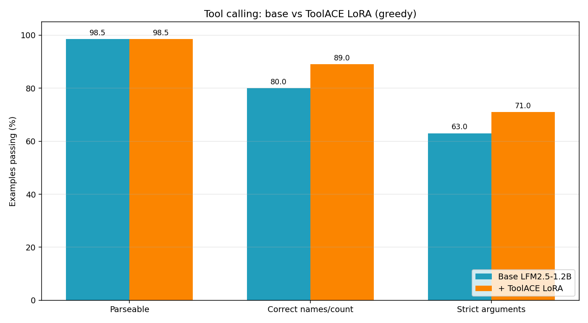
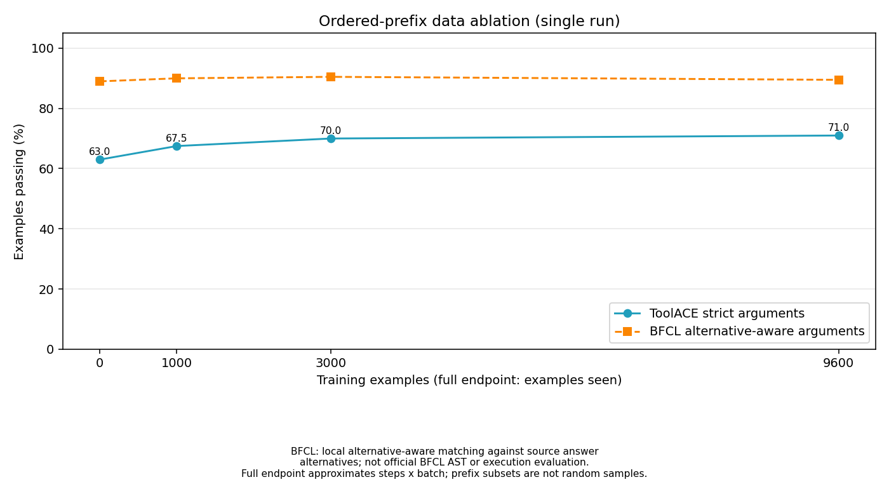
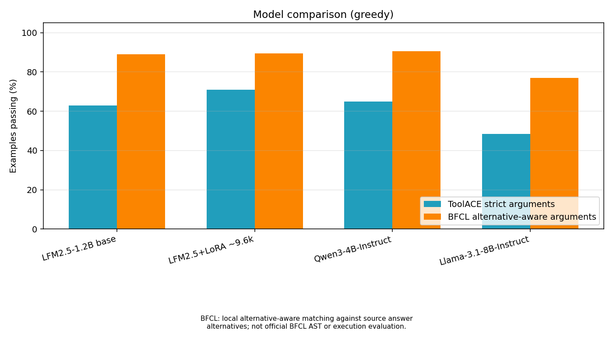
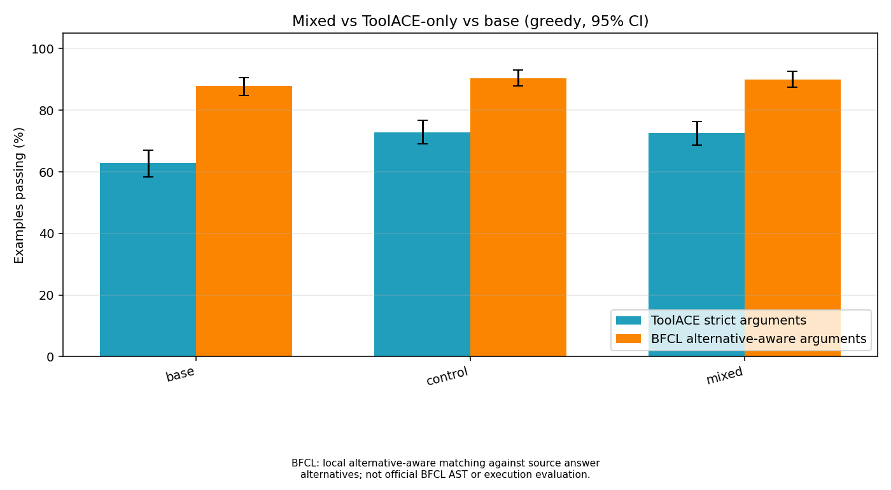
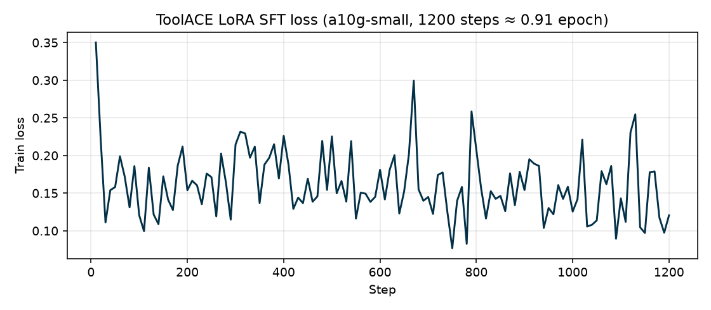

# toolcall-distill

A tool-calling fine-tuning experiment with LiquidAI/LFM2.5-1.2B-Instruct:
prepare ToolACE data, train a LoRA adapter, and evaluate generated tool calls.

On a 500-row ToolACE test split, strict argument accuracy was **62.8% base,
72.8% ToolACE-only LoRA, and 72.6% mixed-data LoRA**. A separate local BFCL
alternative-aware metric gave **87.8%, 90.4%, and 90.0%**. These are experimental
results, not official BFCL leaderboard scores. See [methods and results](docs/experiment.md).
The trained LoRA adapters are not published yet; reproducing them requires
retraining with the scripts in this repository.

## Result charts

Committed copies live in `docs/images/` (rendered with
`python scripts/make_charts.py --output-directory docs/images`;
`loss_curve.png` is the committed historical training-log render).







The model-comparison, mixed-data, and ablation charts show the
**alternative-aware** BFCL scores from the rescored results; none is an
official BFCL score.

## Known measurement note: extra BOS token

The sampling, BFCL, external-model (Qwen/Llama), and 500-row evaluation runs used a
render-then-tokenize path that added one extra BOS token to every prompt. The original
ToolACE-200 baseline and post-training runs did not. Base and trained models received
the same prompt in each comparison, so the comparisons are paired, but absolute numbers
in those runs may differ slightly from a single-BOS run. `scripts/run_eval_job.py`
uses native tokenization and no longer adds the extra token.

## Quick start: offline tests

Python 3.10+ is required. Run from the repository root.

```sh
python -m venv .venv
```

Activate the environment:

```powershell
# Windows PowerShell
.\.venv\Scripts\Activate.ps1
```

```sh
# Linux / macOS
source .venv/bin/activate
```

```sh
python -m pip install -r requirements-dev.txt
python -m pytest -q
```

The default suite requires no datasets, credentials, model downloads, or GPU.
Integration tests are excluded by default. See [data preparation](data/README.md)
for the public downloads needed to run `python -m pytest -q -m integration`.

## Prepare data and generate predictions

For these optional steps, install the data/inference dependencies:

```sh
python -m pip install -r requirements.txt
python prepare_data.py
python eval_toolcalls.py generate --model LiquidAI/LFM2.5-1.2B-Instruct --input data/test.jsonl --output results/predictions.jsonl --limit 3 --device cpu
python eval_toolcalls.py score --predictions results/predictions.jsonl --gold data/test.jsonl --summary results/scores.json
```

The last command scores the whole gold set: missing predictions count as failures.
For a limited pipeline smoke, `python scripts/run_cpu_smoke.py` creates and scores
a matching three-row gold subset. Public downloads and local compute are used;
these commands do not submit paid jobs. Generation can require substantial RAM.
Use a PyTorch build suitable for your CPU/CUDA hardware.

`prepare_data.py --test-count 200 --seed 42` is the original split. Defaults
produce `data/train.jsonl` and `data/test.jsonl`; `--output-directory` selects a
new destination. The larger mixed-data build is documented in [data/README.md](data/README.md).

## Formats and scoring

Training rows have `id`, `tools` (OpenAI-style function definitions), and
`messages`. Test rows also have `prompt_messages` (without the answer) and
ordered `gold_tool_calls`: `[{"name": "...", "arguments": {...}}]`.
Pass `tools` separately to `tokenizer.apply_chat_template`. LFM's native format is:

```text
<|tool_call_start|>[weather(city="Dhaka")]<|tool_call_end|>
```

Predictions contain `id` and either `raw_output` or structured
`predicted_tool_calls`. The parser handles LFM markers, Pythonic lists, JSON,
Qwen tool-call blocks, and Llama JSON streams without executing model output.

The three levels are parseable call, correct ordered tool names/count, and
correct arguments. Arguments compare recursively: dictionaries ignore key
order; lists preserve order; strings are stripped; numeric/boolean strings can
match their respective typed values. Booleans do not equal numeric 0/1.
Missing predictions fail; duplicate or unknown IDs raise errors.

BFCL's raw answers allow alternatives and optional omissions. The converter
keeps one answer for the historical strict metric. `bfcl_scoring.py` joins the
converted `bfcl_id` to raw answers and reports both metrics:

```sh
python bfcl_scoring.py --gold data/larger_eval/ood_test_500.jsonl --prediction base=results/larger_eval/predictions/preds_base_ood.jsonl --prediction control=results/larger_eval/predictions/preds_control_ood.jsonl --prediction mixed=results/larger_eval/predictions/preds_mixed_ood.jsonl --output results/larger_eval/bfcl_alternative_scores.json
```

Supply your own prediction files. The alternative-aware metric accepts each
listed nonempty-string value; a source empty string permits omission, not a
supplied empty value. Extra arguments and wrong call names/order/count still
fail. It reuses the normalization above and performs no official AST or
execution checks. Reports include per-example results, input hashes, and paired
bootstrap intervals. A strict-score drop alone does not establish worse generalization.

## Training and GPU runners

Training uses Unsloth on a compatible Linux/CUDA machine. It has a separate
PEP 723 dependency block in `scripts/train_toolace_sft.py`; do not combine its
historical TRL/Transformers pins with the local inference environment. Follow
the [upstream Unsloth setup](https://huggingface.co/datasets/unsloth/jobs) for your hardware.

```sh
uv run scripts/train_toolace_sft.py --train-jsonl data/train.jsonl --max-steps 1200 --save-local results/training/adapter
```

Training saves locally by default. Uploading requires both `--push-to-hub` and
an explicit `--output-repo your-account/your-adapter`; uploads are private
unless you also pass `--public-repo`.
Credentials belong in your local environment or the provider's secret store.

All evaluation experiments now use `scripts/run_eval_job.py`. Each invocation
loads one base model, optionally adds an adapter, and processes one explicit
JSONL input. Scoring remains a separate local command.

Validate the dataset and CLI settings without importing model packages or
creating an output file:

```sh
python scripts/run_eval_job.py --model LiquidAI/LFM2.5-1.2B-Instruct --input data/test.jsonl --output results/baseline/predictions.jsonl --check-inputs
```

The runner accepts `--model`, optional `--adapter`, `--input`, `--output`,
`--device` (CPU by default), `--dtype`, `--max-new-tokens` (256 by default), and
`--limit`. Greedy decoding is the default. Sampling requires `--sample`; its
defaults are temperature 0.7, top-p 0.9, and seed 0. The seed resets per example,
as in the historical sampling scripts. `--dtype auto` uses float32 on CPU and
bfloat16 on supported CUDA hardware, otherwise float16. Resolved device/dtype
and decoding settings are recorded with each prediction.

Predictions are flushed after each example, including on a later inference
failure. Existing outputs are protected unless `--overwrite` is explicit.
`--log-marker NAME` emits a gzip/base64 `NAME_BEGIN/NAME_END` block, including
partial outputs when an inference error propagates. Neither dataset answers nor
scoring are needed during generation.

### Evaluation recipes

These commands run inference on the selected machine; they do not submit HF
Jobs. Use adapter IDs or local adapter paths you can access. Add `--device cuda`
when running on a CUDA machine. Historical settings are shown, but the refactor
uses a single native-template tokenization path; exact historical outputs are
not guaranteed.

```sh
# Base model, original ToolACE-200
python scripts/run_eval_job.py --model LiquidAI/LFM2.5-1.2B-Instruct --input data/test.jsonl --output results/baseline/predictions.jsonl

# Post-training or ablation: point --adapter at the full, 1k, or 3k adapter
python scripts/run_eval_job.py --model LiquidAI/LFM2.5-1.2B-Instruct --adapter your-account/your-adapter --input data/test.jsonl --output results/posttrain/predictions.jsonl

# BFCL greedy: omit --adapter for the base comparison
python scripts/run_eval_job.py --model LiquidAI/LFM2.5-1.2B-Instruct --adapter your-account/your-adapter --input data/ood_test.jsonl --output results/ood/predictions.jsonl

# ToolACE sampling: repeat for seeds 11, 22, and 33, with separate output paths
python scripts/run_eval_job.py --model LiquidAI/LFM2.5-1.2B-Instruct --input data/test.jsonl --output results/sampling/base_seed11.jsonl --sample --temperature 0.7 --top-p 0.9 --seed 11

# External models: repeat with each ToolACE/BFCL input
python scripts/run_eval_job.py --model Qwen/Qwen3-4B-Instruct-2507 --input data/test.jsonl --output results/qwen/toolace.jsonl
python scripts/run_eval_job.py --model meta-llama/Llama-3.1-8B-Instruct --input data/test.jsonl --output results/llama/toolace.jsonl
```

Llama-3.1-8B-Instruct is gated on Hugging Face: you must be logged in and
accept its license before the model can be downloaded. Qwen3-4B is not gated.

```sh
# Larger evaluation: repeat for base, control, and mixed on each input
python scripts/run_eval_job.py --model LiquidAI/LFM2.5-1.2B-Instruct --input data/larger_eval/toolace_test.jsonl --output results/larger_eval/predictions/preds_base_toolace.jsonl --log-marker PREDS_BASE_TOOLACE_B64_GZ
python scripts/run_eval_job.py --model LiquidAI/LFM2.5-1.2B-Instruct --input data/larger_eval/ood_test_500.jsonl --output results/larger_eval/predictions/preds_base_ood.jsonl --log-marker PREDS_BASE_OOD_B64_GZ
```

For larger control/mixed runs, add `--adapter`, replace `base` in the output
filename with `control`/`mixed`, and replace `BASE` in the marker with
`CONTROL`/`MIXED`. Supply all six prediction files to the local scoring steps;
no model IDs are selected through hidden environment defaults.

Score saved outputs using `eval_toolcalls.py score` and `bfcl_scoring.py` as
shown above. If using hosted logs, `extract_job_markers.py` recovers the runner's
blocks. `collect_larger_eval.py` accepts both historical and new larger-eval
markers and calculates strict summaries/bootstrap intervals locally:

```sh
python scripts/collect_larger_eval.py --log-path results/larger_eval/combined_job_logs.txt --toolace-gold data/larger_eval/toolace_test.jsonl --ood-gold data/larger_eval/ood_test_500.jsonl --output-directory results/larger_eval
```

For hosted jobs, make the repository source and prepared input files available
inside the job and pass explicit `--input` and `--output` paths. A lone script upload is not a
complete bundle. Hosted GPU submissions can incur charges; none are launched
by setup or tests. Historical adapters and raw prediction logs are not included,
so matching the published scores requires retraining or supplying saved outputs.

## Charts

The single chart CLI reads saved summaries; it does not generate predictions
or re-score results. Install the optional plotting dependencies, then render:

```sh
python -m pip install -r requirements-analysis.txt
python scripts/make_charts.py
# Render one chart from partial results, or validate without plotting:
python scripts/make_charts.py --chart mixed --output-directory results/charts
python scripts/make_charts.py --chart mixed --check-inputs
```

`--results-directory` selects the source directory (default: `results/`).
`--output-directory` defaults to that same directory. `--chart` accepts `all`
(the default), `before-after`, `ablation`, `models`, or `mixed`. Selecting `all`
requires all four summaries, and the ablation/models/mixed charts additionally
read the saved alternative-aware BFCL reports; missing/invalid inputs fail
before any images are written. `--check-inputs` needs only Python, not the
plotting packages.

| Chart | Source under results directory | Output PNG |
| --- | --- | --- |
| before-after | `comparison.json` | `before_after_toolcall.png` |
| ablation | `ablation/summary.json` + `bfcl_alternative_scores_200.json` | `ablation_curve.png` |
| models | `models/comparison.json` + `bfcl_alternative_scores_200.json` | `model_comparison.png` |
| mixed | `larger_eval/summary.json` + `larger_eval/bfcl_alternative_scores.json` | `mixed_vs_original.png` |

The ablation, model-comparison, and mixed charts plot the **alternative-aware**
BFCL argument rates from the saved `bfcl_scoring.py` reports. None of these are
official BFCL AST scores; see [the experiment report](docs/experiment.md) for
that distinction. Existing images are replaced when rendered to the same
directory. Sampling and training-loss plots are outside this CLI; the committed
`docs/images/loss_curve.png` is a historical training-log render, not a
chart-CLI output.

## Repository contents

- Root Python modules: conversion, parsing, scoring, and bootstrap statistics.
- `scripts/`: data builders, file-based GPU runners, log collectors, and chart helpers.
- `tests/`: offline behavior/CLI tests and an optional downloaded-data integration check.
- `docs/`: public experiment report and compact result summary.
- `data/`: tracked selection metadata plus ignored local datasets.
- `results/` and `.local/`: ignored generated outputs and private working files.

The dependency files pin direct packages from the checked local environment;
they are not a full cross-platform lock. GPU training dependencies remain
hardware-dependent. The chart CLI uses `requirements-analysis.txt`
and requires the corresponding generated result files.

## Citation

If you use this code or these results, please cite the repository:

```bibtex
@misc{kabir2026toolcalldistill,
  author       = {Rahat Kabir},
  title        = {toolcall-distill: Fine-tuning small LLMs for reliable tool calling},
  year         = {2026},
  howpublished = {\url{https://github.com/Rahat-Kabir/toolcall-distill}}
}
```

## Attribution and license

See [THIRD_PARTY.md](THIRD_PARTY.md) for models, data sources, and training-script
provenance. Dataset and model terms are separate from this project's code.
Project code is MIT (see [LICENSE](LICENSE)), except `scripts/train_toolace_sft.py`,
which adapts an upstream Unsloth script with unconfirmed terms and is excluded
from that license.
